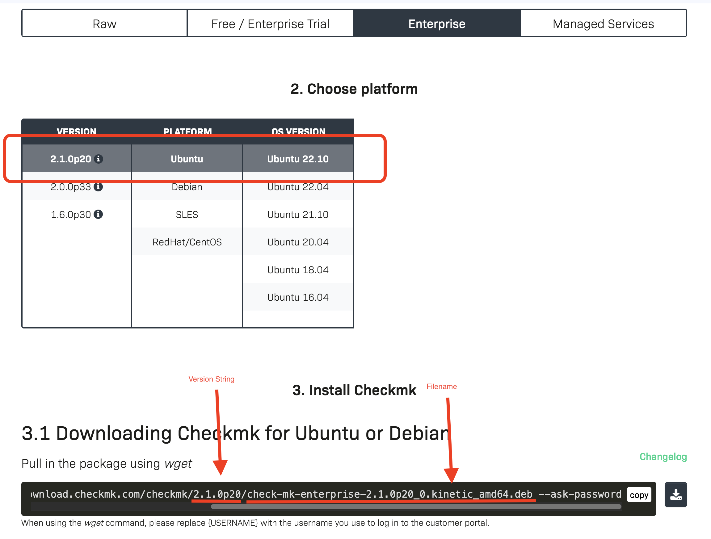

# Checkmk Site Management

The Included Playbook cmk_server_mngmnt.yml makes use of the following functions:

- Installation of Checkmk Versions
- Creation of Checkmk Sites
- Updates of Checkmk Sites

## How It works

Configure your Checkmk Target Version, and your Checkmk Sites inside the Syncer. 
Then run the Playbook.  The Configuration can be Found in **Rules→ Checkmk**

Now the Details:

### CMK Server Settings
**Rules →Checkmk →CMK Server Settings**  
Here you set the Target Version you want to use. The needed information can be found on the Checkmk Download Page:

If you place the Checkmk Installation Package in the staging directory (see *Installation Staging Path* below, `/tmp` by default) it will be used. If not, the System will try to download it, using the supplied credentials. Then it's transferred to your remote server. That means these servers do not need an internet connection.

!!! note "Staging outside `/tmp`"
    The installer is staged **on the controller** (the Syncer host). When the web UI runs under mod_wsgi the worker gets a private `/tmp` (`PrivateTmp=yes`) that later steps can't see, and it is wiped on restart. If a run fails because the copied file "can't be found on the Ansible Controller", set *Installation Staging Path* to a directory outside `/tmp` (e.g. `/var/cmdbsyncer/files`) that the web user can read and write.

When you create a rule, you find the following options:

| Option | Description |
|:-------|:------------|
| Name | Name of config set |
| Server User | User for Ansible to connect to the Server. Sudo needs to be possibe |
| CMK Version | Version's String like 2.1.0p19 |
| CMK Edition | The edition as `omd` names it. Up to 2.4: Enterprise, RAW, Cloud or MSP. From 2.5 on: Community, Pro, Ultimate or Ultimate with Multi-Tenancy |
|CMK Version Filename | Filename like found on the cmk download server, example: check-mk-enterprise-{{CMK_VERSION}}_0.bullseye_amd64.deb |
| Installation Staging Path | Controller directory the downloaded installer is staged in. Empty = `/tmp`. Set a path outside `/tmp` when the executing user can't reliably use `/tmp` (permission issues, or the private `/tmp` under mod_wsgi). |
| Inital Password | This password will be set for new sites |
|Subscription Username/ Password | Your Checkmk Subscription Account |
| Download Proxy | Optional proxy for the download from checkmk.com, e.g. `http://proxy.example.com:3128`. Credentials can be referenced as `{{ACCOUNT:name:password}}`. Empty = the proxy settings of the Ansible controller's environment |

Note: For the CMK Version Filename, you can use the Placeholders {{CMK_VERSION}} and {{CMK_EDITION}}

#### Fill in from checkmk.com

Below the filename the form offers **Fill in from checkmk.com**. A click loads
the current version of every Checkmk major release and its installation files
from checkmk.com. Pick the version and the platform (Ubuntu, Debian, RHEL,
SLES or the Checkmk Appliance) and **Apply** fills in version, edition and
filename. The filename keeps `{{CMK_VERSION}}` in place of the version, so it
stays valid when only the version is changed later. Checkmk 2.5 renamed its
editions; applying a version switches the edition to the name of its release.

The list is only loaded on that click, by the Syncer, through the *Download
Proxy* of the saved settings. Without internet access the form just says so,
and the examples below the button still show the format.

### CMK Sever Sites
**Rules →Checkmk →CMK Server Sites**  
As Second you add all your Sites here. Every Entry references to a Server Setting entry.
Make sure that the operating system will match to the Server Settings.

| Option | Description |
|:-------|:------------|
| name | Site Name |
| Server Address | Address of Server for SSH (without protocoll) |
| Settings Master | Select the CMK Server Settings Entry |

As a current limit, the System can only manage one Checkmk Site per Server. 

#### Custom Ansible Variables
For each Site, you can set Ansible Custom Variables if you need special Settings to reach the site. That could be every Variable, supported by Ansible

### Run the automation
With the settings done, you can run Ansible now.

`ansible-playbook -i cmk_server_inventory cmk_server_mngmt.yml`

