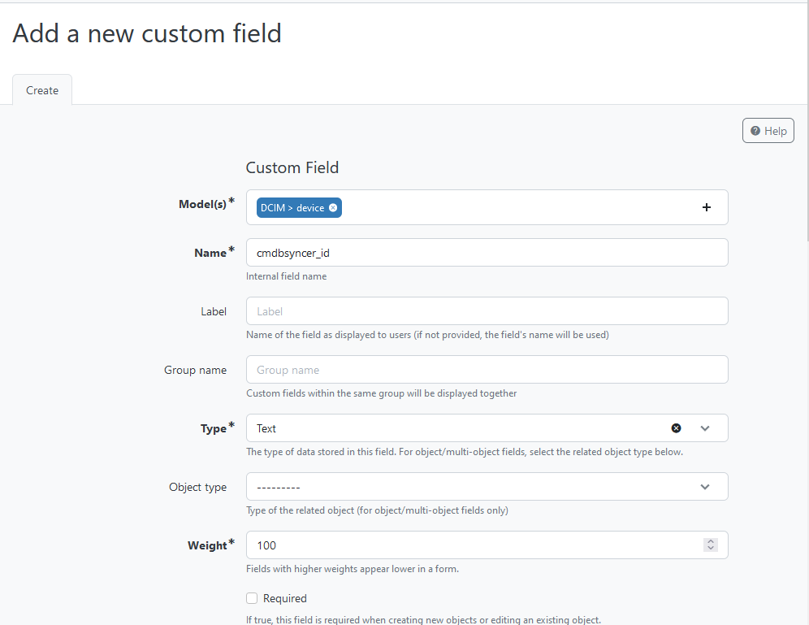

## Setup of Netbox
You need at Least an API Key, to Set up the Connection as Account in Syncer.
To create one, login to Netbox and switch to Admin → API Token.
This Token you have to set as Password for the Syncer Account you use with Netbox.

If the Netbox Installation is a new one, also make sure to set a Default Location (Site) which is required for every Device you create.

Also, you need to Set up a Reference Field for the Devices, that the Syncer can mark systems owned by him. This Field does not need to be Visible, and the Syncer uses it to store the Account ID in there. This way, the Syncer knows which Device was created by him. 



The final Step then is the configuration for the Attributes you want to sync; otherwise there will be an exception when you try to export your Hosts. 


## Special Options in Rules

The Rules support some options which simplify some cases.
Refer to [here](../basics/list_mode.md) to learn more.

## Decommission Data
Hosts and Virtual Machines are automatically Decommissioned in case they are not longer part of the Syncer Database, but have been created by it.

## From a pasted list

The rules for devices, virtual machines, clusters, prefixes, interfaces, IP
addresses, contacts and Dataflow fields can take a pasted list as their input
instead of the hosts: set **Rule source** to **From a pasted list**. Every row
creates one object; a device or virtual machine is named by the row's
`hostname` (or `name`) column.

A row of an interface rule describes interfaces of the device (or virtual
machine) its `hostname` column names, for example:

```text
hostname;port;ip
sw01;eth0;10.0.0.1/24
sw01;eth1;10.0.1.1/24
```

with the outcomes Name `{{ port }}`, Name of Assigned Device `{{ HOSTNAME }}`
and IPv4 Address list `{{ ip }}`. A new interface gets the Netbox ID of that
device when Numeric ID of Device stays empty. In an IP address rule, Assigned
Object ID is the Netbox ID of the interface or its name, which is then looked
up on the device the row names. Unlike for a host, nothing is written back
into an inventory.

See [Rules from a Pasted List](../basics/list_source.md) for the list itself.
